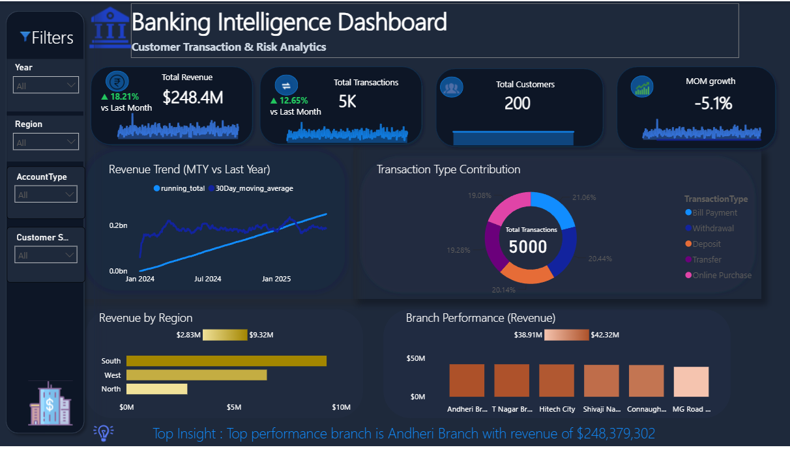
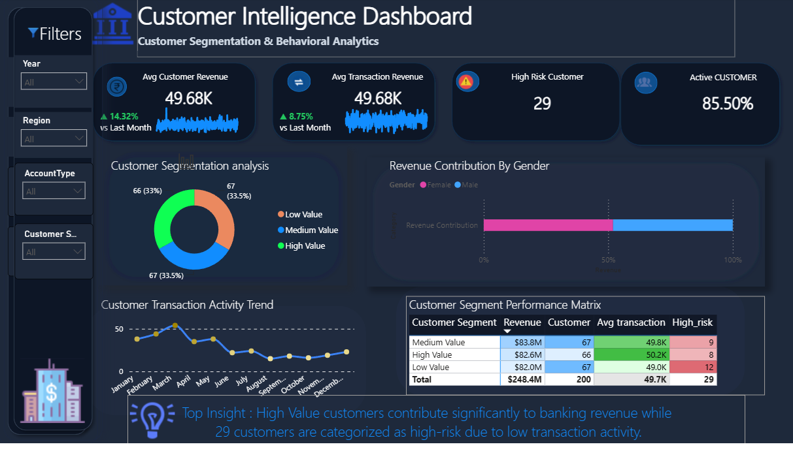
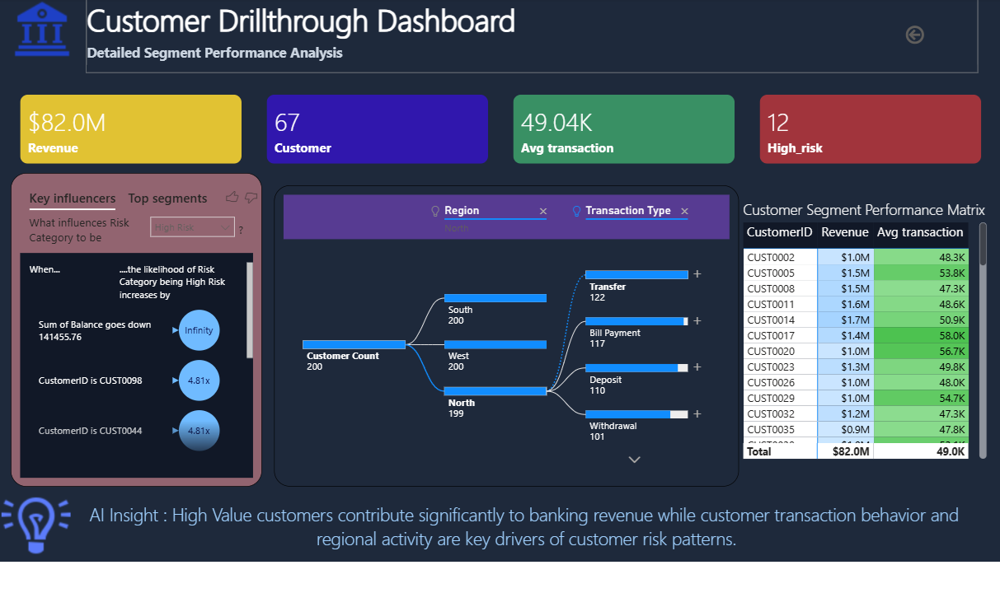

# 🏦 Banking Customer Behaviour Analysis | Power BI

An end-to-end Power BI project analysing customer, account, branch and transaction data of a retail bank, with a 3-page interactive dashboard, DAX measures, and AI visuals for risk analysis.

**Tools:** Power BI Desktop · Power Query · DAX · Data Modelling (Star Schema) · Key Influencers · Decomposition Tree

---

## ⭐ STAR Summary

### S: Situation
A retail bank collects large volumes of customer, account and transaction data across multiple branches and regions, but leadership had no single view of business performance, customer behaviour or risk. Questions like *"Which regions and branches drive revenue?"*, *"Which customer segments are most valuable?"* and *"Who are the high-risk customers?"* were hard to answer quickly.

### T: Task
Build an interactive Power BI dashboard that:
- Tracks core KPIs (customers, transactions, revenue, MoM growth)
- Shows revenue by region, branch, segment, gender and transaction type
- Identifies **high-risk** and **active** customers
- Lets users drill from the summary down to a single customer

### A: Action
- **Data model:** Loaded and cleaned **5 source tables** (`Customers`, `Accounts`, `Branches`, `Transactions`, `Calendar`) plus a `Customer_AI_Table`, connected in a **star schema**. Added a dedicated `measure table` for all DAX.
- **DAX measures:** Wrote measures for `total_customer`, `total_transactions`, `total_revenue`, `mom_growth`, `running_total`, `30Day_moving_average`, `average_transaction_value`, `avg_customer_revenue`, `Active_Customers_Percentage`, `High_risk`, plus dynamic text measures (`key_insight_text`, `Customer Insight`, `AI_Insight`).
- **Dashboard (3 pages, 1280×720):**
  1. **Business Overview:** 4 KPI cards with trend sparklines, revenue trend vs 30-day moving average, transaction-type donut, revenue by region, branch performance, auto-generated key insight.
  2. **Customer Intelligence:** High-risk customers, avg transaction value, active customer %, avg customer revenue, segment donut, revenue by gender, activity trend, and a segment performance matrix.
  3. **Customer Drillthrough:** Per-customer view with **Key Influencers** (what drives risk category) and **Decomposition Tree** (customer count by region, transaction type, gender, balance).
- **Interactivity:** 4 synced slicers (Customer Segment, Account Type, Region, Year), navigation buttons, drillthrough filters, custom dark theme with icons.

### R: Result
| KPI on dashboard | Change vs last month |
|---|---|
| Total Revenue | ▲ **18.21%** |
| Total Transactions | ▲ **12.65%** |
| Avg Customer Revenue | ▲ **14.32%** |
| Avg Transaction Value | ▲ **8.75%** |

- One dashboard replaces manual reporting across regions, branches and segments.
- Revenue concentration by region and branch is visible at a glance.
- High-risk customers can be found and drilled into in a few clicks, with AI-explained risk drivers.

---

## 📊 Project at a Glance

| Item | Count |
|---|---|
| Report pages | **3** |
| Visuals (charts, cards, matrices, AI visuals) | **~30** across pages |
| Slicers | **4** (Segment, Account Type, Region, Year) |
| Data tables | **7** (5 source + 1 AI table + 1 measure table) |
| DAX measures | **15+** |
| Total records | **1,400+** rows across the 4 main tables |

### Data Tables
| Table | Rows | Columns | Key fields |
|---|---|---|---|
| Customers | 200 | 7 | 
| Accounts | 200 | 5 | 
| Branches | 6 | 5 | 
| Transactions | 999+ | 7 |


## 🖼️ Dashboard Preview

### 1. Business Overview
KPIs for customers, transactions, revenue and MoM growth, with revenue trend, region and branch performance.



### 2. Customer Intelligence
Segment analysis, high-risk customers, active customer %, and revenue contribution by gender.



### 3. Customer Drillthrough
Customer-level view with Key Influencers and Decomposition Tree to explain risk drivers.



## 📁 Repository
```
├── banking_powerbi.pbix
├── Business_Overveiw.png
├── Customer_intelligence.png
├── Customer_Drillthrough.png
└── README.md
```

## 🚀 How to Use
1. Download `banking_powerbi.pbix`.
2. Open it in Power BI Desktop.
3. Use the slicers and the page-navigation buttons; right-click a customer to drill through.

